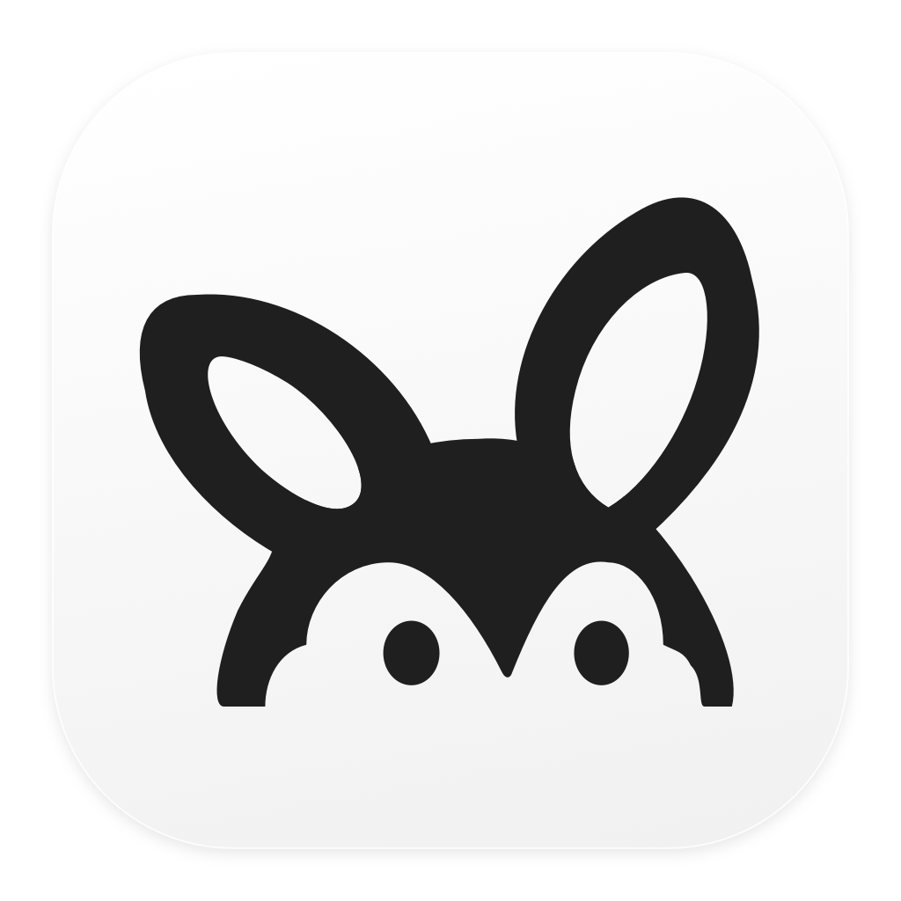

<p align="center">
  
</p>

<h1 align="center">Bilby</h1>

<p align="center">English | <a href="README.zh-CN.md">简体中文</a></p>

<p align="center">Give your Mac’s menu bar some breathing room.</p>

A native macOS menu bar tool for showing and hiding third-party app icons.

Currently tested only on **macOS 27.2 · Apple Silicon**.

## Download

Get the DMG from [Releases](https://github.com/Evenss/Bilby/releases). This preview is not notarized; see the release notes for first-launch guidance.

## Usage

On first launch, grant Accessibility access in System Settings. Click the Bilby icon in the menu bar to manage your app icons.

The interface supports English and Simplified Chinese and follows your macOS app language setting.

## Build from source

Requires a full Xcode installation and Python 3.

```sh
git clone https://github.com/Evenss/Bilby.git
cd Bilby
Tools/build.sh
```

Move `build/Bilby.app` to Applications and open it.

To create a preview DMG: `Tools/package-dmg.sh`.

[MIT License](LICENSE) · [Third-party notices](THIRD_PARTY_NOTICES.md) · [Contributing](CONTRIBUTING.md)
